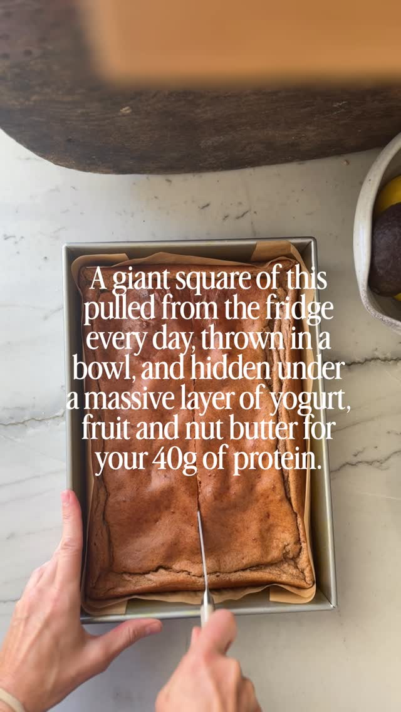

# Apple Cinnamon Protein Bake

High-protein breakfast bake from Lillie Eats and Tells — 242 calories and 24.7 g of protein per big square, or about 450 cal / 40 g of protein loaded with toppings.

Source: [Facebook reel](https://www.facebook.com/share/r/1YTTfcBU8w/) · [original video](https://www.facebook.com/lillieeatsandtells/videos/breakfast-240-cal-and-24g-of-protein-per-big-square-the-way-i-love-to-top-it-to-/1126727866614474/)

## Ingredients

- 1 ½ cup rolled oats (161 g)
- 1 cup apples, diced (112 g)
- 1 ½ cup cashew milk (or other milk; 360 g)
- ¾ cup liquid egg whites (180 g)
- ¾ cup low-fat cottage cheese (180 g)
- 1 cup snickerdoodle or vanilla protein powder (120 g)
- ¼ cup flaxmeal (26 g)
- 2 Tbsp vanilla extract (30 g)
- 2 Tbsp cinnamon
- 1 ½ tsp baking powder
- ½ tsp kosher salt

## Method

1. Preheat the oven to **350°F / 175°C**.
2. Blend all ingredients in a high-speed blender until smooth.
3. Pour the batter into a parchment-lined casserole dish — 9 × 13 in for 6–10 servings, or a sheet pan if making 12+ servings.
4. Bake for **40 minutes**, until set.
5. Enjoy warm out of the oven, or store in the fridge and eat cold throughout the week (the author prefers them cold). Top with no-sugar syrup, yogurt, whipped cream, fresh fruit, a drizzle of nut butter — whatever you love.

## Notes

- **Nutrition** (base recipe): serves 6, serving size 169 g — 242 calories, 4.6 g fat, 27 g carbs, 24.7 g protein, 3.8 g fiber.
- With toppings the author's plate comes to about 450 calories and ~40 g of protein; use fewer toppings for a lighter version.
- **GF:** use gluten-free oats.
- **DF swaps:** dairy-free ricotta or yogurt instead of cottage cheese, and a dairy-free protein powder (the author recommends Active Stacks Vanilla, a beef protein).
