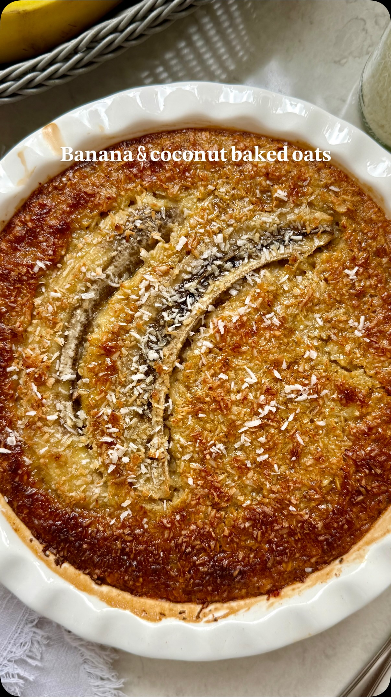

# Banana & Coconut Baked Oats

Cake-for-breakfast baked oats with ripe banana and coconut — filling, nutritious and reheats beautifully, so it works for weekend breakfast or meal prep.

Source: [Eat Happy Feel Good — Facebook video](https://www.facebook.com/eathappyfeelgood/videos/banana-coconut-baked-oats-christiannanutritionist-baked-oats-really-do-feel-like/28548844604815519/) (recipe by Christianna Nutritionist)

Date added: 2026-11-17

## Ingredients (serves 4)

- 2 cups / 200 g jumbo oats
- 2 large ripe bananas
- optional: 1 additional banana for the top
- 1 tsp baking powder
- 1/4 tsp fine salt
- 2 large eggs (or 2 flax eggs)
- 400 ml coconut milk
- 1/4 cup / 60 ml honey
- 1/4 cup / 60 ml oat milk
- 2 tablespoons desiccated coconut

## Method

1. Preheat the oven to 180°C.
2. Put 2 bananas in a baking dish and mash well. Add the eggs, coconut milk and honey. Mix to combine well.
3. Add the oats, baking powder and salt. Mix again.
4. Cut the third banana in half lengthways and gently put it on top.
5. Bake for around 30 minutes, until the top is golden brown and it's just set.
6. Serve with Greek yoghurt and a little extra honey.

## Notes

- Nutrition values were not provided in the source — not calculated here.
- The source method doesn't say explicitly when to add the oat milk (it is listed in the ingredients).
