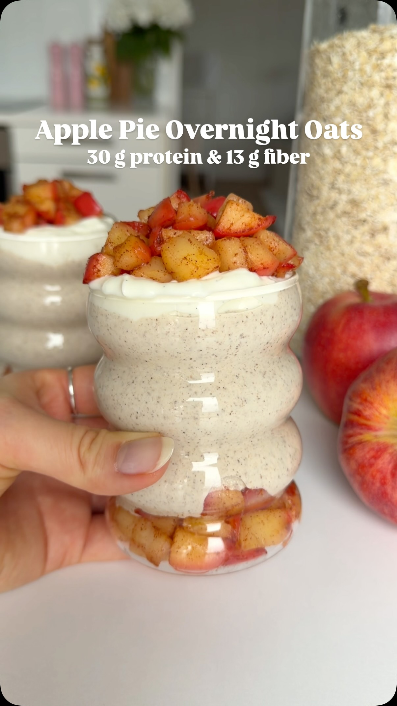

# Blended Apple Pie Overnight Oats

Creamy, pudding-like overnight oats blended with a cinnamon apple mixture — a fall breakfast meal-prep idea with (as claimed by the author) 30 g protein and 13 g fiber.

Source: [Fitfoodieselma — Facebook video](https://www.facebook.com/fitfoodieselma/videos/blended-apple-pie-overnight-oats-30-g-protein-13-g-fiber-these-are-a-delicious-b/2313513149494223/)

Date added: 2026-11-14

**Yield: two servings.**

## Ingredients

For the apples:

- 1 teaspoon butter
- 2 diced apples
- juice of 1 lemon
- 1/2 teaspoon cinnamon

For the overnight oats:

- 1 cup rolled oats (240 ml)
- 2 tablespoons chia seeds
- 1/2 cup high-protein Greek yogurt (120 ml)
- 1 1/3 cup milk (320 ml)
- 1 scoop vanilla protein powder
- 1 teaspoon vanilla paste/extract
- 1/2 teaspoon cinnamon
- pinch of nutmeg
- optional: 1 tablespoon maple syrup or honey

Optional topping:

- vanilla skyr

## Method

1. Heat the butter in a pan. Add the diced apples, lemon juice and cinnamon and stir. Cook for about 5 minutes, stirring occasionally, until the apples have softened. Let cool down.
2. Add half of the apple mixture into a blender with the overnight oats ingredients and blend until creamy.
3. Pour into two jars. Top with the rest of the apple mixture.
4. Let set in the fridge in an air-tight jar/container for at least two hours or overnight and enjoy.

## Notes

- The post claims "30 g protein & 13 g fiber" without stating the basis; the recipe makes two servings.
- Nutrition values were not provided beyond that claim — not calculated here.
