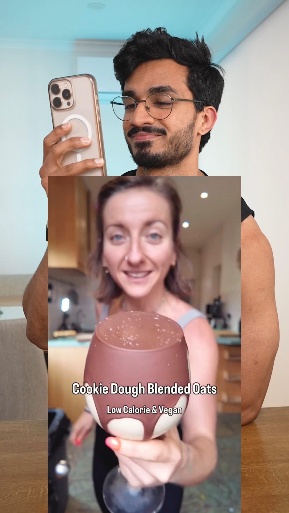

# Cookie Dough Blended Oats

Blended cookie-dough-style oats bowl — secretly loaded with chickpeas and cauliflower, sweetened with dates, finished with a dark chocolate lid. Recipe by @broccoli_mum.

Source: [Facebook video](https://www.facebook.com/share/v/1GMzamjub5/) · [original video](https://www.facebook.com/ralston.dsouza.39/videos/cookie-dough-blended-oatsrecipe-by-broccoli_mum-ingredientsto-a-blender-add-12-c/2776974222699243/) · recipe credit: @broccoli_mum (via Ralston D'Souza)

## Ingredients

- ½ cup cooked chickpeas
- ½ cup oats
- 1 cup boiled and cooled cauliflower
- 3 dates for sweetness
- 1 tsp vanilla extract
- a pinch of salt
- 1 tsp baking powder
- 200 ml milk
- 1 banana
- 15 g chocolate chips (mixed into the bowl)
- 15 g dark chocolate (melted on top)

## Method

1. Add everything except the chocolates to a blender; blend until smooth and creamy.
2. Transfer the mixture to a container and mix in 15 g chocolate chips.
3. Melt 15 g dark chocolate and pour it over the top, spreading it evenly.
4. Refrigerate for **20 minutes**, until the chocolate hardens.
5. Enjoy.

## Notes

- **Nutrition for the ENTIRE bowl:** 730 kcal · 27 g protein · 118 g carbs · 21 g fat · 21 g fiber.
- Cauliflower and chickpeas are the base — the taste target is cookie dough, per the original video.
