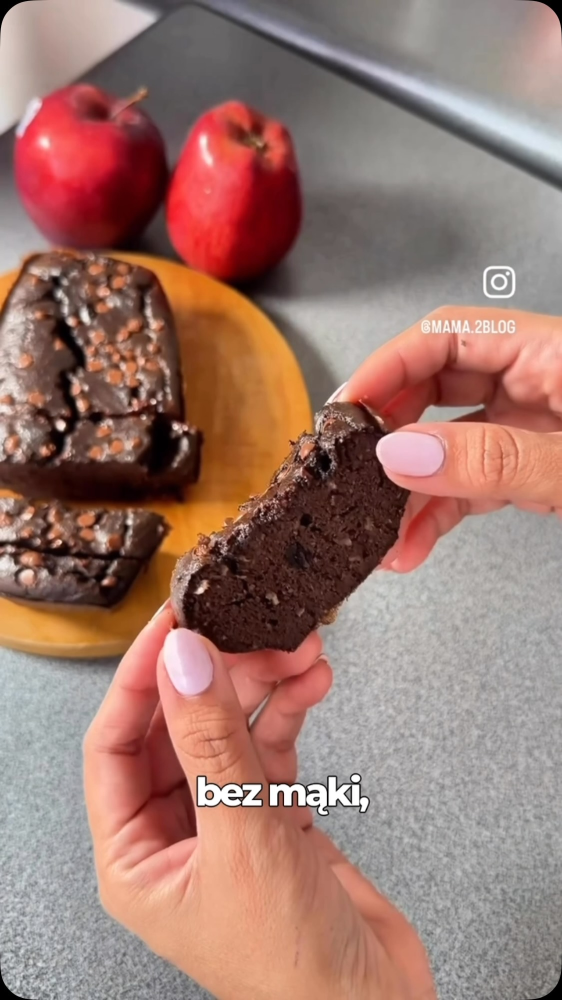

# 3-Ingredient Apple Cocoa Brownie

The simplest chocolate dessert out there: a whole apple-cocoa cake blended from three ingredients — good macros, ready in minutes. Rated 8/10 by the author.

Source: [Facebook video](https://www.facebook.com/share/v/1CF7yecbTv/) · [original video](https://www.facebook.com/ikbenhubert/videos/-zapisz-przepis-bo-prostszego-deseru-ju%C5%BC-chyba-nie-znajdziesz-810-makro-dobre-sz/1136305655587674/) · recipe credit: @mama.2blog (via IkbenHubert Fitness)

## Ingredients

- 1 large apple (200 g)
- 2 eggs (L)
- 2 tsp cocoa (10 g)
- optional: chocolate pieces (the author swapped them for cinnamon)

## Method

1. Core the apple and cut it into chunks.
2. Put it in a blender with the eggs and cocoa.
3. Blend until smooth.
4. Pour into a small cake mold, as in the video (add the chocolate pieces — or cinnamon, as the author did).
5. Bake at **180°C for about 30–35 minutes**, until the cake sets.
6. Cool and eat.

## Notes

- **Macro for the WHOLE cake:** 310 kcal · 17 g protein · 36 g carbs · 13 g fat.
- Meant as a quick sweet snack, e.g. in the evening.
- Original rating: 8/10 — good macros, fast, only 3 ingredients.
